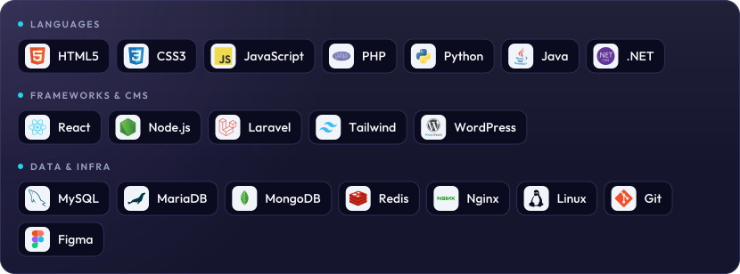

<picture><source media="(max-width: 700px)" srcset="assets/m/header.svg"></picture>

<picture><source media="(max-width: 700px)" srcset="assets/m/s-about.svg"></picture>
<picture><source media="(max-width: 700px)" srcset="assets/m/bento.svg"></picture>

<picture><source media="(max-width: 700px)" srcset="assets/m/s-stack.svg"></picture>
<picture><source media="(max-width: 700px)" srcset="assets/m/stack.svg"></picture>

<picture><source media="(max-width: 700px)" srcset="assets/m/s-links.svg"></picture>

<a href="https://mohsinali373.github.io/portfolio/"><picture><source media="(max-width: 700px)" srcset="assets/m/link-portfolio.svg"></picture></a><a href="https://imagefinch.com/blog/"><picture><source media="(max-width: 700px)" srcset="assets/m/link-blog.svg"></picture></a><a href="mailto:mohsinali.seo123@gmail.com"><picture><source media="(max-width: 700px)" srcset="assets/m/link-email.svg"></picture></a><a href="https://linkedin.com/in/mohsin-ali-93644a297"><picture><source media="(max-width: 700px)" srcset="assets/m/link-linkedin.svg"></picture></a>

<picture><source media="(max-width: 700px)" srcset="assets/m/s-stats.svg"></picture>

<a href="mailto:mohsinali.seo123@gmail.com"><picture><source media="(max-width: 700px)" srcset="assets/m/footer.svg"></picture></a>

Plain-text version (select and copy)

 

<b>Mohsin Ali</b> - SEO specialist and full-stack developer from Pakistan. Building WordPress plugins, automation tools and AI-powered platforms.

<ul>
<li><b>Working on:</b> Automation Suite</li>
<li><b>Learning:</b> AI model self-hosting, PHP/MySQL architecture</li>
<li><b>Looking for help with:</b> Self-hosting open-weight AI models on a server</li>
<li><b>Ask me about:</b> WordPress plugins, SEO, Vibe Coding, WHM/cPanel automation, Servers</li>
<li><b>Fun fact:</b> I automate everything I can, then spend the saved time automating more</li>
<li><b>Portfolio:</b> <a href="https://mohsinali373.github.io/portfolio/">mohsinali373.github.io/portfolio</a></li>
<li><b>Blog:</b> <a href="https://imagefinch.com/blog/">imagefinch.com/blog</a></li>
<li><b>Email:</b> <a href="mailto:mohsinali.seo123@gmail.com">mohsinali.seo123@gmail.com</a></li>
<li><b>LinkedIn:</b> <a href="https://linkedin.com/in/mohsin-ali-93644a297">mohsin-ali-93644a297</a></li>
</ul>

