<!-- Mohsin Ali / GitHub profile README | static SVG artwork with CSS + SMIL animation -->

  

  

  

  

  

### Featured project

| Project | What it does | Implementation |
|:--|:--|:--|
| **Automation Suite** | Browser-based Cloudflare, WHM/cPanel and WordPress automation. Aurora and Classic provide the same tools. | Flask backend; standalone app served by Waitress at `127.0.0.1:5005` by default. |

  

  <a href="https://github.com/mohsinali373">GitHub</a> &nbsp;·&nbsp;
  <a href="https://linkedin.com/in/mohsin-ali-93644a297">LinkedIn</a> &nbsp;·&nbsp;
  <a href="https://instagram.com/darkpresence_01">Instagram</a> &nbsp;·&nbsp;
  <a href="https://fb.com/mohsinali373">Facebook</a>

